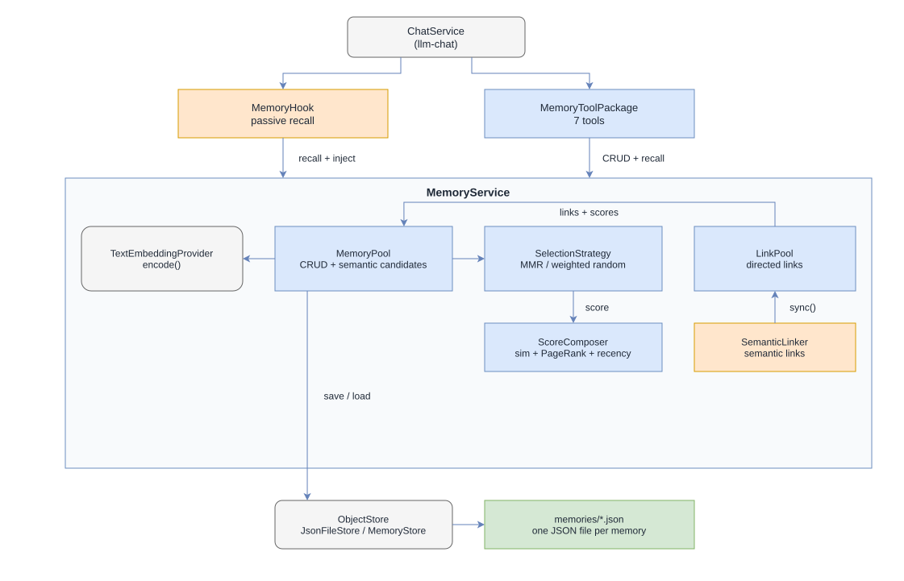

# Architecture



## Persistent memory for finite context windows

LLM conversations have a finite context window. Old messages, including facts the agent learned earlier, get pushed out when the window fills up, gets compacted, or a sliding window moves. A fact mentioned 50 messages ago is gone.

This package solves that by giving agents a **persistent memory store**: a place to write facts, notes, and decisions that survive across turns, conversations, and restarts.

## Shared: semantic recall via embedding similarity

Memories are matched to conversation context using **embedding-based cosine similarity**, not keyword triggers. Every memory's content is encoded into a vector embedding (cached inside the memory JSON file, invalidated when the memory changes). On recall, the incoming message is encoded once and compared against all cached embeddings. The most semantically similar memories, above a configurable similarity floor, qualify as candidates.

This means paraphrase, synonymy, and indirect references all match: "my dog is sick" matches a memory about "the veterinarian visit" even though they share no keywords.

Tags are concatenated to the content during embedding, acting as a semantic anchor for internal jargon.

The hook and the `recall_memories` tool share the same recall pipeline:

```text
1. Encode   →  embed the input message into a query vector
2. Score    →  cosine similarity between query vector and all cached memory embeddings
3. Filter   →  absolute floor (default ~0.4) + elbow-based relative cutoff
4. Select   →  MMR or weighted random sampling (configurable) 
               using composite score = α·sim + β·pageRank + γ·recency
5. Cap      →  per-message limit (`maxInject` or `maxInjectPerMessage`)

Passive injection adds:
6. Deduplicate → skip memories already injected in this session and apply
                 the per-send-loop cap
7. Inject      → batch tool-call with ids + summaries (see hooks.md)
```

## Memory anatomy

Every stored memory is:

| Field | Why it exists |
|---|---|---|
| `id` | Uniquely identifies the memory (sanitised from the label, also the filename) |
| `content` | The text to remember |
| `summary` | Short summary (at least 50 chars; at most `max(600, 20% of content length)`). Shown during injection; full content fetched on demand. |
| `tags` | Categories used to augment the embedding input |
| `score` | PageRank importance: higher score = more linked-to |
| `createdAt` / `changedAt` / `recalledAt` | Track when it was made, edited, last surfaced |
| `embedding` | Cached vector + `cachedAt` timestamp for invalidation |
| `links` | This memory's **outgoing** directed links (explicit + semantic), persisted inside its own file |

Triggers (word/regex/tag) are removed. Semantic similarity handles recall fully.

## The service

`MemoryService` is the central entry point. It owns both a `MemoryPool` (pure CRUD + recall) and a `LinkPool` (link graph). Semantic similarity links are recomputed by running the semantic linker (`service.linker.sync()`).

```typescript
const service = new MemoryService(config, embedder);
await service.init();  // pool.initialize() + linkPool.load() + score()
await service.recall(message);  // pool.recall() + select via strategy + mark recalled
```

### Passive recall (hookInto)

`service.hookInto(chatService)` creates a per-call `MemoryHook` and registers
it on the ChatService `beforeSendLoop` and `afterSend` hooks. The hook recalls
semantically related memories, injects each at most once per session through a
single batched `get_memory` call, and returns a disposable handle. See
[hooks.md](hooks.md) for the callback roles, tracking, and injection limits.

### Active recall (recall_memories tool)

The `recall_memories` tool runs the same recall pipeline on demand. This is
**non-invasive**: the agent controls when and what to look up, which is useful
for explicit lookups such as "check what I know about topic X". See
[`recall_memories`](tools/recall-memories.md).

## File storage

Each memory is an individual JSON file in the `memories/` subdirectory, named
after its slug id. Content, tags, summary, its cached embedding vector, and
its outgoing links are stored in the file:

```text
./memories/
  project-context.json
  installation-notes.json
  user-preferences.json
```

The directed link graph is stored **inside each memory file** via the `links`
field: every memory carries its own outgoing links (explicit constant links
plus semantic-similarity links). Links are flushed eagerly whenever the graph
changes (link/unlink/isolate/sync), so there is no separate `links.json`. On
startup, `service.init()` loads the individual memory files, rebuilds the
in-memory link graph from each file's `links` field, then recalculates
PageRank scores.

This makes it easy to inspect, backup, or edit memories directly. No database needed.

### Directory store integration (json-file-store)

Every `MemoryPool` is always backed by an `ObjectStore<MemoryJSON>` from the
`@johannes.latzel/json-file-store` package. All save/load/delete operations
route through `store.set`/`store.get`/`store.delete`; `initialize()` only
lists the memories directory and loads each file through the store.

By default the `MemoryPool` uses an in-memory `MemoryStore`. For durable file
storage, `MemoryService` constructs a `JsonFileStore` over
`config.memoryDir` when no store is supplied, so a default service persists
memories to disk. A caller-supplied store always takes precedence.

Memory ids are file-safe lowercase slugs, so they double as the JSON filenames
used by `JsonFileStore` without any id mapping or migration. Corrupt entries
are skipped individually during `initialize()`.
